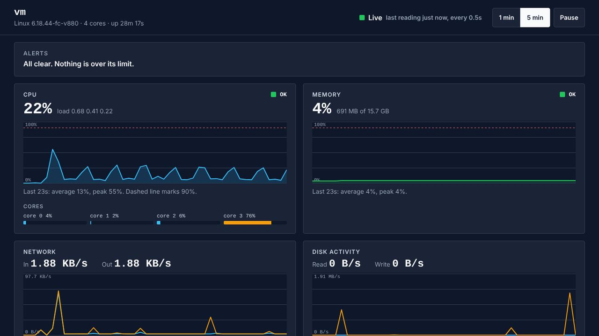

<h1 align="center">Server Monitoring Dashboard</h1>

<p align="center"><b>A live dashboard for one machine. No accounts, no API keys, no CDN.</b></p>

<p align="center">
     
</p>

<p align="center">
  
</p>

A live dashboard for one machine: CPU (total and per core), memory, disk space, disk activity, network traffic and the busiest processes. Python collects the numbers, the browser draws them as charts.

Everything is open source and runs locally. There are no accounts, no API keys, no CDN scripts or web fonts, and nothing is sent anywhere. The only dependency is [psutil](https://github.com/giampaolo/psutil) (BSD-3).

## Run it

Needs Python 3.10 or newer.

```bash
pip install .
server-monitor                      # http://localhost:8765
server-monitor --interval 1 --warn 70 --crit 85
```

| Option | Default | |
| --- | --- | --- |
| `--host` | `127.0.0.1` | address to bind; anything other than this machine needs `--token` |
| `--port` | `8765` | |
| `--interval` | `2` | seconds between readings (minimum 0.5) |
| `--history` | `150` | readings kept for the charts (about 5 minutes at 2s) |
| `--warn` / `--crit` | `75` / `90` | percent at which a metric turns amber / red |
| `--token` | none | require this token; can also be set with `MONITOR_TOKEN` |
| `--allow-host` | none | extra `Host` value to accept when no token is set |
| `--no-processes` | off | don't collect or show process names |

To watch a remote machine, run it there with a token and put it behind your own HTTPS (a reverse proxy such as Caddy or nginx), then open `https://host/?token=...`. The token is removed from the address bar once the page loads.

## What the page shows

- **Alerts first.** A band at the top lists anything over its limit, or says all is clear.
- **State is a word, not just a colour.** Each panel shows OK, WARN or CRIT next to a coloured square.
- **Live means live.** The header shows Connecting, Live, Paused or Stale. If no reading arrives for three intervals, it says Stale instead of showing old numbers as current.
- **Charts** cover the last 1 or 5 minutes and have a text summary for screen readers. `P` pauses and resumes.
- It respects reduced-motion settings, works by keyboard, and reflows to one column on a phone.

Read-only image filesystems (squashfs, ISO and similar) are left out of the disk list and read-only mounts never raise alerts, because they are full by design.

## Security notes

- Binds to `127.0.0.1` by default. The CLI refuses a public address unless a token is set.
- Without a token, requests whose `Host` header isn't `localhost` or `127.0.0.1` get a 403, which stops a web page on another origin from reading your readings through DNS rebinding.
- A strict Content-Security-Policy is sent with every response (`default-src 'none'`, scripts and styles from this server only). Only five fixed files are served, so there is no path traversal.
- Process names can be sensitive. Use `--no-processes` if the dashboard is shared.
- The token is compared in constant time. It travels in the query string for the live stream (browsers can't set headers on `EventSource`), so use HTTPS when it crosses a network.

## Run as a service

```ini
# /etc/systemd/system/server-monitor.service
[Service]
ExecStart=/usr/local/bin/server-monitor --port 8765
Restart=on-failure
DynamicUser=yes

[Install]
WantedBy=multi-user.target
```

## Tests

```bash
pip install -e ".[dev]" && pytest          # collector and server, including auth and Host checks
node --test tests/js/lib.test.js           # formatting, chart scaling and live/stale logic
```

## Limits

- One machine per instance; there is no fleet view.
- History lives in memory and resets when the process restarts.
- No temperature or GPU readings.

## Project layout

```text
monitor/collector.py   reads CPU, memory, disk, network and processes with psutil
monitor/server.py      HTTP server, live stream (SSE), token and Host checks, CSP
monitor/cli.py         command-line options
monitor/web/           index.html, app.js, lib.js (formatting, scaling, stale logic), style.css
tests/                 pytest for the collector and server, node:test for lib.js
```

## Licence

MIT

Part of my [portfolio](https://kcarnage1.github.io/My-Persona-Portfolio/).
